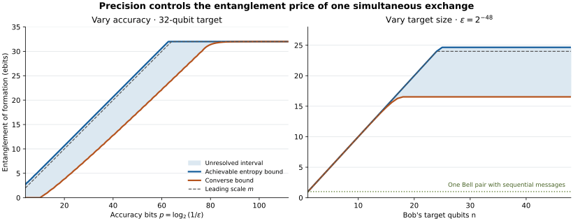

# Remote Gate Entanglement Cost

**How much entanglement replaces a feedback step in a remote quantum gate, and how does that price depend on accuracy?**

Alice holds one control qubit and Bob an $`n`$-qubit target. They want to apply a controlled phase gradient using local operations and one simultaneous exchange of **classical** messages. This project proves a quantitative entanglement lower bound allowing arbitrary finite mixed resources, arbitrary local quantum memory, and arbitrary local processing. An explicit construction matches its leading dependence on precision.

Let $`E_{\mathrm{sim}}(n,\epsilon)`$ be the infimum of the resource's entanglement of formation, in ebits, when the gate error is at most $`\epsilon`$ in **half diamond distance**. For $`n\ge1`$ and $`0<\epsilon\le1/2`$,

```math
m-\log_2[16(m+1)]-3
\le E_{\mathrm{sim}}(n,\epsilon)\le m+2,
\qquad
m=\min\!\left\{n,\frac12\log_2\frac1\epsilon\right\}.
```

The [finite theorem](science/frontier.md) provides stronger parameter-dependent bounds and an explicit range for a uniform $`\Theta(\min\{n,\log(1/\epsilon)\})`$ statement. The additive gap above is logarithmic in $`m`$; the exact finite-error optimum is not determined.

| Communication pattern | Gate accuracy | Entanglement conclusion |
|---|---|---|
| Two sequential directed messages | Exact | One Bell pair is sufficient and optimal |
| One simultaneous classical exchange | Exact | Exactly $`n`$ ebits |
| One simultaneous classical exchange | Half diamond error $`\epsilon>0`$ | Leading cost $`m`$, with the finite bounds above |

The exact costs and standard remote-control construction are [established results](references/RELATED_WORK.md). The contribution developed here is the robust mixed-resource converse and the resulting precision-dependent tradeoff for this structured gate family.



*The shaded region lies between the proved converse and an achievable entropy upper bound. Curves evaluate analytic inequalities; they are not empirical performance measurements. At fixed nonzero error, the upper bound is independent of the target size. [Figure source](verification/plot_frontier.py).*

## Read the science

Start with the [target, operational model, and resource definitions](science/model.md). The [converse](science/converse.md) develops the unrestricted mixed-resource lower bound, the [protocols](science/protocols.md) give the physical constructions, and the [frontier](science/frontier.md) combines them into the quantitative result.

| To inspect | Read |
|---|---|
| Input, output, communication, accuracy, and resource assumptions | [Model](science/model.md) |
| Purification, no-signalling, cyclic averaging, and entropy extraction | [Complete converse](science/converse.md) |
| Tapered resource, exact error channel, and inherited exact protocols | [Protocols](science/protocols.md) |
| Finite inequalities, leading coefficient, and exact endpoints | [Accuracy–entanglement frontier](science/frontier.md) |
| Offline preparation, local gates, messages, and synthesis precision | [Resource accounting](science/resource_accounting.md) |
| An alternative upper bound using unbiased phase rounding | [Randomized spectral rounding](science/randomized_rounding.md) |
| Why exact spectral distinctness differs from finite accuracy | [Physical interpretation](science/interpretation.md) |
| Earlier results, nearby communication models, and attribution | [Related work](references/RELATED_WORK.md) and [bibliography](references/references.bib) |
| Reproducible finite checks and their limits | [Verification](verification/README.md) |

[The LLM reading guide](llms.txt) maps scientific questions to their authoritative files.

## Learn the project

The [30-milestone map](learning/MILESTONES.md) develops 13 background targets followed by 17 targets through the scientific argument. Both phases move from individual objects and mechanisms to the complete operational picture.

The single educational anchor is John Watrous, [*The Theory of Quantum Information*](https://cs.uwaterloo.ca/~watrous/TQI/) (2018). The [Watrous bridge](learning/WATROUS_BRIDGE.md) identifies the relevant sections, connects their definitions to this project's proof and constructions, and works through a small remote-gate example. It also identifies the additional primary results needed beyond the book. The milestone map describes the project's understanding targets; the linked science files contain the full claims and proofs.

## Mechanism

The construction correlates Alice's control with a one-step shift of the shared resource. After the simultaneous exchange and local corrections, the remaining error is exactly control dephasing. A sine-shaped resource profile has overlap

```math
f_R=\cos\frac\pi{R+1},
\qquad
\epsilon_R=\frac{1-f_R}{2}=O(R^{-2}),
\qquad E_F\le\log_2R.
```

The converse applies to every admissible protocol. Approximate no-signalling invariance, averaged over the cyclic phase action, forces a local Fourier-input test to extract high conditional entropy from the shared resource. A dimension-independent entropy estimate makes this argument valid even with arbitrarily large finite workspaces and mixed resources. The exact distinct-spectrum theorem, fast cyclic protocols, and sine-state ideas have prior origins, separated from the finite-error result in [related work](references/RELATED_WORK.md).

## Reproduce the finite checks

From the repository root:

```bash
python3 -m pip install -r verification/requirements.txt
python3 verification/run_all.py
python3 verification/plot_frontier.py
```

The checks independently contract the physical local operations, verify the resulting channel and preparation steps, evaluate the finite bounds, and check unbiased phase rounding. The universal converse and asymptotic laws are established by the written proofs and cited theorems. Numerical checks do not replace those proofs. See [verification](verification/README.md) for expected outputs, tolerances, and scope.

## Scope

The lower bound concerns the controlled phase-gradient family and one simultaneous exchange of classical messages. The tapered upper protocol applies to any **known** binary-controlled unitary when its local powers and inverses can be implemented at their charged cost. Offline entanglement preparation and local gate precision are included in the resource account. No QRAM or free data loading is used.

Entanglement entropy, one-shot Bell-pair preparation cost, and total physical runtime are distinct quantities. The result matches the leading entanglement cost; it does not claim an additive-constant optimum, a runtime advantage, or an entanglement-only lower bound with free quantum messages.

## Purpose and contact

This repository serves as a record of the work and a guide for the author’s self-directed learning. For discussion or potential collaboration, please contact Ruge Lin at [gogoko699@gmail.com](mailto:gogoko699@gmail.com).
